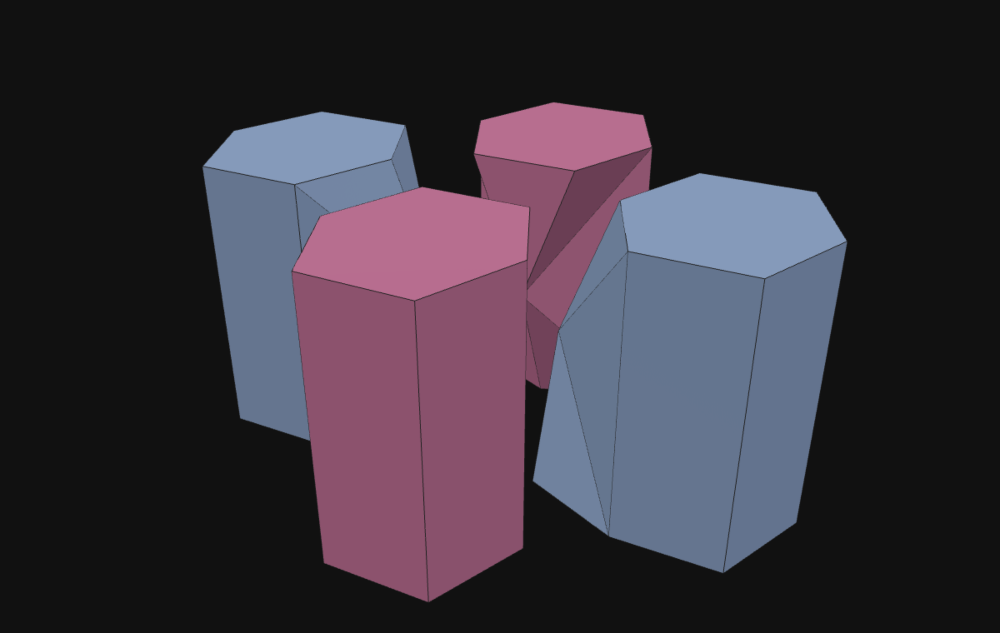
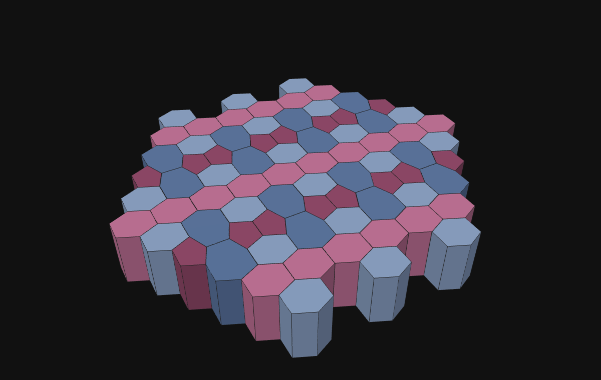

# Scutoids

A scutoid is a prism-like shape whose two ends have different numbers of sides. Part way up, one of its corners splits in two (or two merge into one), which gives it a triangular side face.

Scutoids show how nature solves a fundamental 3D packing problem: bending a layer of cells into curved shapes without tearing, collapsing, or wasting energy.

Before scutoids were discovered in 2018, textbooks taught that epithelial cells (the tightly packed cells that line our skin, organs, and blood vessels) were shaped like simple prisms or tapered frustums (truncated pyramids). However, when biologists and mathematicians modeled how these tissues actually bend into tubes, spheres, and folds, they realized simple prisms couldn't pack tightly without leaving gaps.

### The Main Point of Scutoids

* Minimizing energy during bending: By swapping neighbors partway down their height via a Y-shaped edge split, cells can curve and twist smoothly while keeping their surface tension and bending energy as low as possible.
* Maintaining a watertight seal: Epithelial tissues act as critical protective barriers (like the lining of your gut or lungs). Scutoids allow cells to pack together with zero gaps even on tightly curved surfaces, preventing leaks.
* Enabling complex organ growth: During embryonic development, flat sheets of cells constantly fold, invaginate, and roll into complex 3D organs like glands, intestines, and neural tubes. Adopting a scutoid shape lets tissues remodel themselves without breaking apart.

### Why They Matter to Science & Engineering

* Tissue engineering & artificial organs: When growing artificial organs or skin grafts in a lab, scientists use scutoid geometry to design better scaffolds so lab-grown cells organize and curve naturally like real human tissue.
* Biomimetic design & architecture: Engineers and materials scientists study scutoids to create stronger, lighter, interlocking modular structures—such as curved architectural facades, flexible armor, and aerospace panels—that distribute mechanical stress evenly without rigid fasteners.

### What is this repo all about then?
In this repo are two 3D-printable scutoids for showing how scutoids pack:

| File | Ends | Size |
|---|---|---|
| `scutoid_5-6.stl` | hexagon on one end, pentagon on the other | about 27 × 27 mm, 40 mm tall |
| `scutoid_6-7.stl` | hexagon on one end, heptagon on the other | about 27 × 35 mm, 40 mm tall |

Both pieces use the same honeycomb of slightly squashed hexagons, so they
fit together and with flipped copies of themselves. With these two models
you can build:

- a full layer of 5-6 and 6-7 pieces, which stacks into layers,
- two or four 5-6 pieces fitted together, some flipped,
- two or four 6-7 pieces fitted together, some flipped.

*A group of four pulled apart: two 5-6 (pink) and two 6-7 (blue). The
back 5-6 shows its triangle; the 6-7 on the right shows a bent face.*

*A packed layer. Groups that are turned over (darker) show pentagons and
heptagons on top; the rest show hexagons.*

## 3D Printing

- Print equal numbers of each piece. 8 + 8 makes a small layer (four
  groups of four, below) with enough to try every arrangement.
- Print standing on either end, with no supports. The sides slope by at
  most about 21° from vertical.
- Each piece is shrunk by 0.15 mm on every side so printed pieces slide
  together. If they're too tight or too loose, change `GAP` in
  `make_scutoids.py` and regenerate (see below).

## Telling the faces apart

Each piece has three kinds of side face:

- **plain faces**: flat upright rectangles,
- **the triangle**: one triangular face. Its wide edge is on the hexagon
  end of a 5-6, and on the heptagon end of a 6-7,
- **two bent faces**, one on each side of the triangle, each folded where
  the triangle's point is, half way up.

The pieces fit together along the triangles and bent faces. The plain
faces fit against any other plain face.

## Arrangements

### A group of four: two 5-6 and two 6-7

This is the building block of a layer.

1. Stand two 5-6 pieces hexagon up, with their triangles pressed together.
   The triangles' points meet half way down.
2. That leaves a notch on each side, between the two 5-6 pieces. Stand a
   6-7 piece hexagon up in each notch. Their bent faces fit against the
   5-6 pieces' bent faces, and their triangles meet under the 5-6 pieces'
   triangles.

The outside of the group is all plain faces, so it stands as a solid
block. Its top shows four hexagons and its bottom two pentagons and two
heptagons.

### A full layer

Put groups of four side by side, all facing the same way (the two 6-7
pieces of every group in a line). The plain faces fill in between groups.

**Any group can be turned over as a whole.** Turn it half a turn about the
line through its two 6-7 pieces and drop it back in. Its top then shows
two pentagons and two heptagons. Mix upright and turned groups however you
like, for example in a checkerboard.

In flat space a layer can't be made of 5-6 pieces alone. The cells of a
flat tiling average exactly six sides, so every pentagon needs a heptagon
to balance it. That's why the layer needs both pieces.

### Stacking layers

Stack groups so that matching faces meet: hexagons on hexagons, and
pentagons/heptagons on pentagons/heptagons. Going up a column, each group
is the other way up from the one below it.

### Two or four 5-6

1. Stand two 5-6 pieces hexagon up with their triangles together, as in
   step 1 of a group.
2. Turn two more over, pentagon up, and stand one in each notch. Each
   turned piece's bent faces fit both upright pieces' bent faces, and the
   two turned pieces' triangles meet at the bottom.

Any two neighbours from these four also fit together as a pair: one
upright and one turned over, along a bent face. This is the pairing shown
in Wikipedia's picture of two flipped 5-6 scutoids.

### Two or four 6-7

The same as with 5-6 pieces:

1. Stand two 6-7 pieces hexagon up with their triangles together. Their
   triangles' points meet half way up, with the wide edges at the bottom.
2. Turn two more over, heptagon up, and stand one in each notch.

Again, any two neighbours make a flipped pair.
